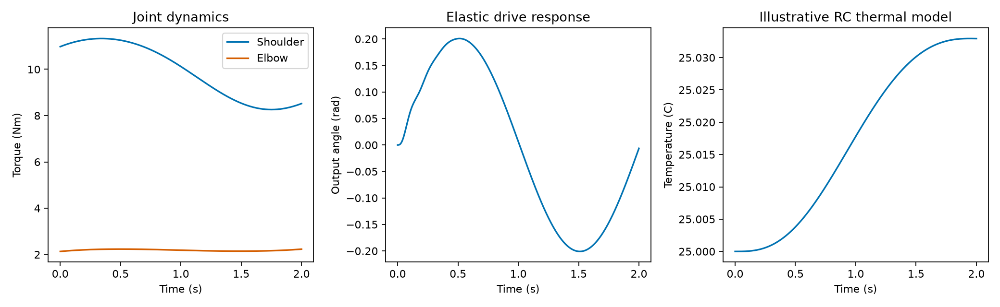

# Robotic Limb Dynamics Analyzer

A two-joint limb-analysis application extending [Robotics Toolbox for Python](https://github.com/petercorke/robotics-toolbox-python). Original author credits, package names and licenses are preserved. Application additions live in `examples/limb_analyzer/`.



## Features

- A planar limb with explicit dimensions, masses and finite rotational inertias.
- Quintic joint trajectories, recursive Newton–Euler torque evaluation and forward-dynamics recovery.
- An idealised harmonic-drive output model with gear ratio, torsional stiffness, damping and load inertia.
- Lumped RC gearbox heating with explicit transmission-efficiency assumptions.
- CSV samples, JSON timing and consistency measurements, and a headless report plot.

This transmission is not a calibrated commercial harmonic drive. Thermal estimates are illustrative post-processing; planetary gear geometry and propulsion-unit modal analysis are not implemented. The application uses Python, Robotics Toolbox, NumPy, SciPy and Matplotlib. OpenCV is not used. The upstream toolbox has C++ extensions and a pure-Python fallback.

## Run

Python 3.12 is the tested environment. In Windows PowerShell:

```powershell
python -m venv .venv
.venv\Scripts\Activate.ps1
$env:RTB_PURE_WHEEL = "1"
python -m pip install -e .
python -m pip install pytest
python -m examples.limb_analyzer.analyze
python -m pytest examples/limb_analyzer/test_analysis.py -q
```

On Linux/macOS, activate with `source .venv/bin/activate`; use `RTB_PURE_WHEEL=1 python -m pip install -e .` if native build tools are unavailable. The Windows run used the pure-Python fallback. Exact versions are in `examples/limb_analyzer/requirements.lock`. Reports default to `examples/limb_analyzer/results/`; `--output` selects another directory.

## Results and requirements

Generated [metrics](examples/limb_analyzer/results/metrics.json), [data](examples/limb_analyzer/results/limb.csv) and [verification](docs/source/PROJECT_VERIFICATION.md) describe the tested experiment. [Project requirements](docs/source/PROJECT_REQUIREMENTS.md) retain all requested improvement figures as acceptance targets, separately from measured outputs.

## Origin and license

Derived from `petercorke/robotics-toolbox-python` at `879fb363580840e19ee70b6b175e8cd3543e2b38`. Peter Corke and Jesse Haviland's [MIT license](LICENSE) and author credits remain intact. Application additions were prepared for Shivam Sharma with Codex assistance. See the [upstream README](docs/source/UPSTREAM_README.md) for original library documentation.
